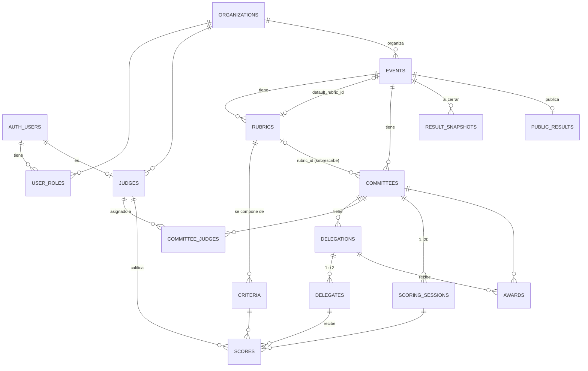

# Rutas y modelo de datos — API MUNYCH

Referencia de todas las rutas del backend y de sus modelos, generada a partir del OpenAPI de la
app (`/api/v1/openapi.json`) y de `supabase/migrations/*.sql`. La fuente de verdad sigue siendo el
código: si algo cambia, `tests/api/test_openapi.py` fija rutas y `operation_id`.

## Índice

1. [Convenciones](#1-convenciones)
2. [Resumen de rutas](#2-resumen-de-rutas)
3. [Detalle por módulo](#3-detalle-por-módulo)
4. [Modelos de la API (schemas)](#4-modelos-de-la-api-schemas)
5. [Modelo de datos (base de datos)](#5-modelo-de-datos-base-de-datos)

---

## 1. Convenciones

| Tema | Regla |
|---|---|
| URL base | `/api/v1` (en local: `http://127.0.0.1:8000/api/v1`) |
| Documentación interactiva | `/api/v1/docs` (Swagger) · esquema: `/api/v1/openapi.json` |
| Autenticación | `Authorization: Bearer <access_token de Supabase>`. El rol viene en el claim `app_role` (`admin` \| `judge`) |
| Formato | JSON en `snake_case`; IDs `uuid`; fechas ISO 8601 en UTC (`date` = `AAAA-MM-DD`) |
| Paginación | `?limit=` (1–200, por defecto 50) y `?offset=` (≥ 0, por defecto 0) → `{ "items": [...], "total": n }` |
| Límite de peticiones | `POST /judge/scores/batch`: 120/min · `POST /judges`: 20/min (→ 429 `RATE_LIMITED`) |

### Errores (`application/problem+json`)

```json
{ "type": "...", "title": "...", "status": 409, "code": "SESSION_CLOSED",
  "detail": "La sesión 2 está cerrada", "errors": [ ... ] }
```

| `code` | HTTP | Cuándo |
|---|---|---|
| `VALIDATION_ERROR` | 422 | Cuerpo o parámetros inválidos (`errors` trae el detalle por campo) |
| `VALUE_OUT_OF_RANGE` | 422 | Nota fuera de `[scale_min, scale_max]` |
| `WEIGHTS_MUST_SUM_100` | 422 | Los pesos de la rúbrica no suman 100 |
| `DELEGATES_LIMIT_EXCEEDED` | 422 | Más de 1 delegado (`single`) o de 2 (`double`) |
| `UNAUTHORIZED` | 401 | Sin token o token inválido |
| `FORBIDDEN` | 403 | El rol no puede usar la ruta |
| `JUDGE_NOT_ASSIGNED` | 403 | El juez no está asignado al comité |
| `NOT_FOUND` | 404 | El recurso no existe (o es de otra organización) |
| `SESSION_CLOSED` | 409 | Calificar en una sesión cerrada |
| `EVENT_CLOSED` | 409 | Escribir en un evento cerrado |
| `EVENT_NOT_CLOSED` | 409 | Publicar un evento que no está cerrado |
| `SESSIONS_STILL_OPEN` | 409 | Cerrar un evento con sesiones abiertas |
| `CONFLICT` | 409 | Conflicto de unicidad o escritura simultánea |
| `RATE_LIMITED` | 429 | Límite de peticiones superado |
| `INTERNAL_ERROR` | 500 | Error inesperado |

---

## 2. Resumen de rutas

Rol: **—** público · **any** cualquier usuario autenticado · **admin** · **judge** (solo sus comités asignados).

| Método | Ruta | Rol | `operation_id` | Cuerpo | Respuesta |
|---|---|---|---|---|---|
| GET | `/health` | — | `health` | — | `{ "status": "ok" }` |
| GET | `/me` | any | `get_me` | — | `MeOut` |
| **Jueces** | | | | | |
| GET | `/judges?event_id=` | admin | `list_judges` | — | `Page<JudgeOut>` |
| POST | `/judges` | admin | `invite_judge` | `JudgeInvite` | 201 `JudgeOut` |
| PATCH | `/judges/{judge_id}` | admin | `update_judge` | `JudgeUpdate` | `JudgeOut` |
| **Eventos** | | | | | |
| GET | `/events` | admin | `list_events` | — | `Page<EventOut>` |
| POST | `/events` | admin | `create_event` | `EventCreate` | 201 `EventOut` |
| GET | `/events/{event_id}` | admin | `get_event` | — | `EventOut` |
| PATCH | `/events/{event_id}` | admin | `update_event` | `EventUpdate` | `EventOut` |
| DELETE | `/events/{event_id}` | admin | `delete_event` | — | 204 |
| POST | `/events/{event_id}/logo` | admin | `upload_event_logo` | multipart `file` | `EventOut` |
| POST | `/events/{event_id}/close` | admin | `close_event` | — | `CloseEventOut` |
| **Comités** | | | | | |
| GET | `/events/{event_id}/committees` | admin | `list_committees` | — | `Page<CommitteeOut>` |
| POST | `/events/{event_id}/committees` | admin | `create_committee` | `CommitteeCreate` | 201 `CommitteeOut` |
| GET | `/committees/{committee_id}` | admin | `get_committee` | — | `CommitteeOut` |
| PATCH | `/committees/{committee_id}` | admin | `update_committee` | `CommitteeUpdate` | `CommitteeOut` |
| DELETE | `/committees/{committee_id}` | admin | `delete_committee` | — | 204 |
| **Delegaciones y delegados** | | | | | |
| GET | `/committees/{committee_id}/delegations` | admin | `list_delegations` | — | `Page<DelegationOut>` |
| POST | `/committees/{committee_id}/delegations` | admin | `create_delegation` | `DelegationCreate` | 201 `DelegationOut` |
| POST | `/committees/{committee_id}/delegations/import` | admin | `import_delegations` | multipart `file` (CSV) | `ImportResult` |
| PATCH | `/delegations/{delegation_id}` | admin | `update_delegation` | `DelegationUpdate` | `DelegationOut` |
| DELETE | `/delegations/{delegation_id}` | admin | `delete_delegation` | — | 204 |
| POST | `/delegations/{delegation_id}/delegates` | admin | `add_delegate` | `DelegateIn` | 201 `DelegateOut` |
| PATCH | `/delegates/{delegate_id}` | admin | `update_delegate` | `DelegateUpdate` | `DelegateOut` |
| DELETE | `/delegates/{delegate_id}` | admin | `delete_delegate` | — | 204 |
| **Rúbricas** | | | | | |
| GET | `/events/{event_id}/rubrics` | admin | `list_event_rubrics` | — | `RubricOut[]` |
| POST | `/events/{event_id}/rubrics` | admin | `create_rubric` | `RubricIn` | 201 `RubricOut` |
| GET | `/rubrics/{rubric_id}` | admin | `get_rubric` | — | `RubricOut` |
| PUT | `/rubrics/{rubric_id}` | admin | `replace_rubric` | `RubricIn` | `RubricOut` |
| **Asignaciones juez–comité** | | | | | |
| GET | `/committees/{committee_id}/judges` | admin | `list_committee_judges` | — | `AssignmentOut[]` |
| PUT | `/committees/{committee_id}/judges` | admin | `replace_committee_judges` | `AssignmentIn[]` | `AssignmentOut[]` |
| **Sesiones y progreso** | | | | | |
| GET | `/committees/{committee_id}/sessions` | admin | `list_committee_sessions` | — | `SessionOut[]` |
| POST | `/committees/{committee_id}/sessions/{number}/open` | admin | `open_session` | — | `SessionOut` |
| POST | `/committees/{committee_id}/sessions/{number}/close` | admin | `close_session` | — | `SessionOut` |
| GET | `/committees/{committee_id}/progress` | admin | `get_committee_progress` | — | `ProgressOut` |
| **Resultados** | | | | | |
| GET | `/committees/{committee_id}/ranking` | admin | `get_committee_ranking` | — | `RankingOut` |
| GET | `/committees/{committee_id}/awards` | admin | `list_committee_awards` | — | `AwardsOut` |
| PUT | `/committees/{committee_id}/awards` | admin | `replace_committee_awards` | `AwardIn[]` | `AwardsOut` |
| PUT | `/committees/{committee_id}/tiebreak` | admin | `set_committee_tiebreak` | `TiebreakIn` | `RankingOut` |
| GET | `/events/{event_id}/export.xlsx` | admin | `export_event_xlsx` | query `ExportOptions` | archivo `.xlsx` |
| GET | `/events/{event_id}/export.csv` | admin | `export_event_csv` | query `ExportOptions` | archivo `.csv` |
| GET | `/events/{event_id}/export.pdf` | admin | `export_event_pdf` | query `ExportOptions` | acta `.pdf` |
| **Publicación** | | | | | |
| GET | `/events/{event_id}/publication-settings` | admin | `get_publication_settings` | — | `PublicationSettings` |
| PUT | `/events/{event_id}/publication-settings` | admin | `update_publication_settings` | `PublicationSettings` | `PublicationSettings` |
| GET | `/events/{event_id}/publication/preview` | admin | `preview_publication` | — | `PublicDocument` |
| POST | `/events/{event_id}/publish` | admin | `publish_event` | — | `PublishOut` |
| POST | `/events/{event_id}/unpublish` | admin | `unpublish_event` | — | `UnpublishOut` |
| **Panel del juez** | | | | | |
| GET | `/judge/committees` | judge | `list_judge_committees` | — | `JudgeCommitteeOut[]` |
| GET | `/judge/committees/{committee_id}` | judge | `get_judge_committee` | — | `JudgeCommitteeDetailOut` |
| GET | `/judge/sessions/{session_id}/scores` | judge | `list_my_session_scores` | — | `ScoreOut[]` |
| POST | `/judge/scores/batch` | judge | `submit_scores_batch` | `ScoresBatchIn` | `ScoresBatchOut` |
| **Votación de delegados** | | | | | |
| GET | `/events/{event_id}/voter-tokens` | admin | `list_voter_tokens` | — | `VoterAccessOut[]` |
| POST | `/events/{event_id}/voter-tokens` | admin | `generate_voter_tokens` | `GenerateTokensIn` | `GeneratedTokenOut[]` (201) |
| POST | `/events/{event_id}/voter-tokens/sheet.pdf` | admin | `voter_access_sheet` | `AccessSheetIn` | hoja `.pdf` |
| POST | `/events/{event_id}/voter-tokens/revoke` | admin | `revoke_voter_tokens` | `RevokeTokensIn` | `{ revoked: number }` |
| GET | `/events/{event_id}/peer-vote` | admin | `list_peer_vote_windows` | — | `CommitteePeerVoteOut[]` |
| PUT | `/committees/{committee_id}/peer-vote` | admin | `open_peer_vote` | `PeerVoteWindowIn` | `PeerVoteWindowOut` |
| POST | `/committees/{committee_id}/peer-vote/close` | admin | `close_peer_vote` | — | `PeerVoteWindowOut` |
| GET | `/vote/ballot` | token de delegado | `get_ballot` | — | `BallotOut` |
| POST | `/vote/ballot` | token de delegado | `submit_peer_vote` | `PeerVotesIn` | `BallotOut` |

Total: **61 operaciones**.

---

## 3. Detalle por módulo

### 3.1 Identidad (`identity`)

- **`GET /me`**: datos del usuario autenticado. `role` es `null` si el usuario no tiene rol asignado.
- **`POST /judges`**: envía la invitación de Supabase por correo y crea el juez con `user_roles(role='judge')`. Si el correo ya existe en Auth, reutiliza ese usuario. Con `event_id`, además lo vincula a ese evento (`app.event_judges`); así se suma a un evento nuevo un juez que ya existía, sin reenviar correo si ya aceptó.
- **`GET /judges` y `GET /judges/invitations`**: aceptan `?event_id=` para listar solo los jueces de ese evento. Asignar un juez a un comité (`PUT /committees/{id}/judges`) también lo vincula al evento del comité.
- **`PATCH /judges/{judge_id}`**: cambia `full_name` y/o `active`. Un juez inactivo deja de recibir el claim `app_role` en sus tokens nuevos.

### 3.2 Eventos (`events`)

- **`POST /events`**: crea el evento en `draft` y su **rúbrica por defecto** (escala 1–4, 6 criterios que suman 100).
- **`PATCH /events/{event_id}`**: `status` solo admite `draft` o `active`. Para cerrar se usa `POST /events/{id}/close`.
- **`DELETE /events/{event_id}`**: solo con el evento en `draft`.
- **`POST /events/{event_id}/logo`**: `multipart/form-data` con el campo `file` (PNG, SVG o WebP; máx. 2 MB). Lo guarda en el bucket `event-logos`.
- **`POST /events/{event_id}/close`**: exige todas las sesiones cerradas (`SESSIONS_STILL_OPEN`), guarda una instantánea inmutable y pone el evento en `closed`. Desde ese momento no se puede escribir en calificaciones ni premios.

### 3.3 Comités, delegaciones y delegados (`events`)

- **`POST /events/{event_id}/committees`**: crea el comité y sus sesiones `1..sessions_count` (cerradas). Si no se envía `award_quotas`, se usan los cupos por defecto del tipo:

  | `type` | best | outstanding | honorable | verbal |
  |---|---|---|---|---|
  | `general_assembly` | 1 | 2 | 2 | 3 |
  | `security_council` | 1 | 1 | 2 | 2 |
  | `crisis` | 1 | 1 | 1 | 2 |
  | `specialized` | 1 | 1 | 2 | 3 |

- **Delegación**: exactamente uno de `country_code` (ISO-3166 alfa-2, p. ej. `MX`) o `character_name`. El país es único dentro del comité.
- **Delegados**: máximo 1 si el comité es `single` y 2 si es `double` (`DELEGATES_LIMIT_EXCEEDED`).
- **`POST /committees/{committee_id}/delegations/import`**: `multipart/form-data` con el campo `file`. El CSV va en UTF-8, separado por comas y con cabecera:

  ```csv
  country_code,character_name,institution,delegate_1,delegate_2
  MX,,Colegio Ejemplo,Ana Pérez López,
  US,,Instituto Norte,John Smith,Mary Jones
  ,Ministro de Defensa,Colegio Sur,Luis Gómez,
  ```

  - Si la fila repite un país que ya existe en el comité, se omite (cuenta en `skipped`).
  - Si trae `delegate_2` en un comité `single`, es un error.
  - Las filas válidas se importan aunque otras fallen.

### 3.4 Rúbricas (`rubrics`)

- **`PUT /rubrics/{rubric_id}`**: reemplaza la rúbrica completa. El orden de `criteria` define `position`.
  - Envía `id` en un criterio para conservarlo; sin `id` se crea uno nuevo.
  - Los pesos deben sumar exactamente 100 (`WEIGHTS_MUST_SUM_100`), y debe cumplirse `scale_min < scale_max`.
- **`POST /events/{event_id}/rubrics`**: crea una rúbrica adicional. Sirve para que un comité use otra rúbrica mediante `committees.rubric_id`.

### 3.5 Asignaciones (`judging`)

- **`PUT /committees/{committee_id}/judges`**: el cuerpo es un **array JSON**, `[{ "judge_id": "...", "role": "chair" }]`, que reemplaza todas las asignaciones del comité. `role` vale `judge` por defecto.
- **Roles y tipo de evento** (2026-11-05): `chair` y `moderator` cuentan como **Mesa Directiva**; `staff` es el staff del evento. En `judges_only` todos califican como un solo grupo. En `mun_regular` un `judge` no califica (sus ítems se rechazan con `FORBIDDEN`); en `national_championship` califican los tres.

### 3.6 Calificación (`scoring`)

- **Sesiones**: se crean cerradas. Abrir una sesión ya abierta o cerrar una ya cerrada es idempotente. Con el evento cerrado responde `EVENT_CLOSED`.
- **`GET /committees/{committee_id}/progress`**: por sesión y por juez, `scored` (celdas calificadas) frente a `expected` (delegados × criterios). El frontend lo consulta periódicamente (*polling*).
- **`POST /judge/scores/batch`**: lote **idempotente** de 1 a 500 ítems.

  ```json
  { "items": [ { "client_id": "uuid", "delegate_id": "uuid", "session_id": "uuid",
                 "criterion_id": "uuid", "value": 3, "comment": "opcional",
                 "client_updated_at": "2026-10-10T15:04:05Z" } ] }
  ```
  ```json
  { "accepted": ["client_id", "..."],
    "rejected": [ { "client_id": "uuid", "code": "SESSION_CLOSED", "detail": "La sesión 2 está cerrada" } ] }
  ```

  - **Validación por ítem**: cada ítem se valida por separado, así que uno inválido no invalida el resto. Códigos posibles: `SESSION_CLOSED`, `EVENT_CLOSED`, `JUDGE_NOT_ASSIGNED`, `VALUE_OUT_OF_RANGE`, `NOT_FOUND`, `VALIDATION_ERROR`, `CONFLICT`.
  - **Upsert**: se hace por `(judge_id, delegate_id, session_id, criterion_id)`. Un `client_id` repetido con los mismos datos se acepta sin cambios.
  - **Última escritura**: si `client_updated_at` es anterior al guardado, el ítem se devuelve en `accepted` pero no cambia nada.
  - **Auditoría**: cada creación o cambio queda registrado en `audit_log`.
- **`GET /judge/committees`**: solo comités de eventos `active` (ni `draft` ni `closed`), ordenados por `starts_on` descendente y luego por nombre. Un mismo juez puede tener comités de varios eventos; `event.name` los distingue.
- **`GET /judge/sessions/{session_id}/scores`**: devuelve solo las calificaciones del juez autenticado, nunca las de otros jueces.

### 3.7 Resultados (`results`)

- **`GET /committees/{committee_id}/ranking`**: ranking calculado con el motor puro.
  - **Nota ponderada**: `Σ (value / scale_max) × weight`, de 0 a 100.
  - **Nota de sesión**: media de los jueces que calificaron todos los criterios.
  - **Nota final**: media de las sesiones.
  - **Nota de la delegación**: media de sus delegados.
  - **Desempate**: por la media del criterio de mayor peso. Si el empate persiste, las delegaciones comparten posición con `tied: true`.
  - Las delegaciones sin notas llevan `score: null` y van al final.
  - **Votación por roles** (`mun_regular`, `national_championship`): la nota anterior se calcula **por rol** (`role_scores`), y la de la delegación es `Σ peso × nota_rol / Σ peso` de los roles **con nota** (un rol sin votos no cuenta como 0). Los delegados no usan la rúbrica: su nota es `puntos recibidos ÷ (3 × votantes que enviaron boleta) × 100`, con Mejor delegado = 3, Delegado distinguido = 2 y Mención de honor = 1 (sin votantes en el comité → `null`). No aporta a `criteria_averages`. Pesos en `role_weights`: MUN regular = mesa 30, delegados 50, staff 20; Campeonato = jueces 50, mesa 15, delegados 25, staff 10.

### 3.7 bis Votación de delegados (`voting`)

- Los delegados **no tienen cuenta**: el admin genera un token por delegado (`POST /events/{id}/voter-tokens` con `link_base`, p. ej. `https://<panel>/#/votar/`) y lo reparte como enlace o QR. El token, el enlace y el QR (SVG) **solo** vienen en esa respuesta; en la BD queda su SHA-256. Sin `delegate_ids` genera para quien no tenga acceso vigente; con `delegate_ids` los regenera y revoca los anteriores. `409 CONFLICT` si en el tipo de evento no votan delegados.
- **Hoja de accesos en PDF** (2026-11-07): `POST /events/{id}/voter-tokens/sheet.pdf` `{ items: [{ delegate_id, token, code, url }] }` con los accesos que acaba de devolver `POST /voter-tokens`. Según la muestra de MUNYCH («Accesos de votación MUNYCH - muestra»): carta, agrupada por comité y ordenada por delegación, 9 tarjetas recortables por hoja con QR vectorial (~3.4 cm), nombre, delegación, «AG · 01/32» y el código de respaldo con la dirección donde escribirlo. Solo imprime accesos **vigentes** (token y código del acceso no revocado ni vencido; si no, `422 VALIDATION_ERROR`); los nombres y comités salen de la base. No guarda nada (`Cache-Control: no-store`).
- **Código corto de respaldo** (2026-11-07): cada acceso trae además `code` (10 caracteres sin 0/O/1/I/L, p. ej. `K7M2Q-9XH4T`, ~50 bits) para escribirlo a mano si la cámara no lee el QR. Sirve igual que el token en `Authorization: Bearer` (se aceptan minúsculas, espacios y guiones). Como el token, solo llega al generarlo y en la BD queda su hash. Los accesos generados antes no tienen código: hay que regenerarlos.
- **Voto entre pares por premios** (desde 2026-11-06): cada delegado vota **una sola vez por comité, al final**, eligiendo Mejor delegado, Delegado distinguido y Mención honorífica (los mismos nombres que los premios oficiales). Las delegaciones deben ser distintas y ninguna la propia; si el comité tiene menos de 3 candidatas, solo se votan los primeros N premios (`awards`).
- **Ventana por comité** (admin): `PUT /committees/{id}/peer-vote` `{ opens_at?, closes_at? }` abre (o programa) la votación; `opens_at` null = ahora y `closes_at` null = abierta hasta cerrarla. Reabrir quita el cierre anterior y conserva los votos. `POST /committees/{id}/peer-vote/close` la cierra ya. **Abrir una sesión** (`POST /committees/{id}/sessions/{n}/open`) también abre el voto entre pares del comité en la misma transacción, salvo que ya esté abierto (se respeta su cierre programado), que el evento esté cerrado o que en el tipo de evento no voten delegados; si estaba programado o cerrado, queda abierto desde ahora y sin cierre. `GET /events/{id}/peer-vote` da por comité `status`, fechas, `voters` (delegados) y `submitted` (cuántos ya votaron). Estado (`PeerVoteStatus`): `not_scheduled` (sin apertura) · `scheduled` (aún no llega `opens_at`, o el evento no está `active`) · `open` · `closed` (pasó `closes_at` o el evento se cerró). `409 CONFLICT` si en el tipo de evento no votan delegados; `409 EVENT_CLOSED` con el evento cerrado; `422 VALIDATION_ERROR` si el cierre no es posterior a la apertura y a ahora.
- **`GET /vote/ballot`** (`Authorization: Bearer <token>`): delegación propia, comité, sesiones (`sessions_total`, `sessions_closed`), ventana (`peer_vote`), peso del rol delegados (`weight`, %), premios a votar, delegaciones candidatas (todas menos la suya) y, si ya votó, `picks`, `submitted_at` y `receipt` (comprobante legible `SIGLAS-XXXX-XX`). El panel la consulta cada 20 s.
- **`POST /vote/ballot`** `{ picks: [{ award_type, delegation_id }] }`: un pick por premio de `awards`. Errores: `401 UNAUTHORIZED` (token inválido, revocado o vencido), `409 SESSION_CLOSED` (la votación aún no abre o ya cerró), `409 EVENT_CLOSED`, `409 CONFLICT` (ya votó: **no se puede cambiar**), `422 VALIDATION_ERROR` (faltan premios o delegación repetida), `403 FORBIDDEN` (su propia delegación), `404 NOT_FOUND` (delegación de otro comité).
- Límite por token (no por IP, porque comparten el wifi): 20 GET/min y 30 POST/min.
- **`PUT /committees/{committee_id}/awards`**: array JSON `[{ award_type, delegation_id, position }]` (`position` vale 1 por defecto) que reemplaza los premios. Superar un cupo **no bloquea**: solo añade avisos a `quota_warnings`.
- **`GET /events/{event_id}/export.xlsx`**: libro de Excel con una hoja **Resumen**, una hoja de ranking por comité y una hoja **Detalle** (delegado × sesión × juez × criterio). Las fechas van en la zona horaria del evento.
- **`GET /events/{event_id}/export.csv`** (2026-11-07): el ranking de todos los comités en una sola tabla (UTF-8 con BOM, comas, punto decimal): comité, siglas, posición, empate, delegación, institución, delegados, nota (y nota por rol si el evento tiene varios), premios y avisos. Sin detalle por juez.
- **`GET /events/{event_id}/export.pdf`** (2026-11-07): **acta de resultados** según la muestra oficial de MUNYCH («Acta de resultados - muestra oficial»). Portada (marca, evento, sede, fechas, zona horaria, hora de generación con su UTC, tipo de evento con los pesos por rol, totales de comités, delegaciones y premios, y el **resumen de premiación** de todos los comités) y una sección por comité («Comité n de N», tipo, delegaciones / con nota / premios, premios asignados o aviso de que no hay, y el **ranking** con posición, empate, delegación con su código ISO, delegados, institución, nota y premios; las delegaciones sin nota van al final sin posición). Pie en todas las páginas. Los nombres de los delegados siguen el `name_format` de la publicación (por defecto «Ana P.»: hay menores). Respeta todas las opciones: `committee_id`, `include_scores` (columna Nota), `include_details` (por comité, **desglose por criterio**: media de cada criterio por delegación, y **calificaciones por sesión**: delegado × sesión × juez con el valor de cada criterio), `include_judge_names` (nombre real del juez; si no, «Juez 1», «Juez 2»…) e `include_comments` (comentarios junto a cada calificación). Con nombres de jueces o comentarios, la portada avisa de que es un **documento interno**. ⚠️ Sin parámetros todo vale `true`: quien llame a la API sin el panel debe mandar las opciones. Carta (US Letter), generado con reportlab.
- **Opciones de exportación** (query, todos los formatos; por defecto, todo): `committee_id` (repetible; sin él, todos los comités), `include_scores` (nota), `include_details` (hoja Detalle, solo XLSX), `include_comments` (comentarios de los jueces en el Detalle), `include_judge_names` (si es `false`, el Detalle dice «Juez 1», «Juez 2»… por comité). El panel los manda desde la pantalla Exportar.
- **Desempate manual** (2026-11-07): `PUT /committees/{id}/tiebreak` `{ delegation_ids }` guarda el orden que decide el admin para las delegaciones que **siguen empatadas** tras el desempate automático. Un empate se resuelve solo si el orden incluye a **todas** sus delegaciones; las demás ids se ignoran; lista vacía = quitar los desempates. Las delegaciones desempatadas llevan `tied: false` y `manual_tiebreak: true`. Se aplica en el ranking, la instantánea, la página pública y los exports. `409 EVENT_CLOSED` con el evento cerrado (hay que desempatar antes de cerrar); `404 NOT_FOUND` si alguna delegación es de otro comité.

### 3.7 ter Gestión de staff (`staff`, 2026-11-08)

El staff es de la **organización**, no de un evento: tipos de staff, personas, miembros, rúbricas y premios se definen una vez. Lo que depende de un evento (candidatos, avance, ranking, asignación y confirmación de premios) usa un **evento de contexto**: `?event_id=` en las rutas que devuelven detalle, o, si se omite, el evento activo más reciente de la organización. Solo admin, salvo las dos rutas del enlace personal. Nada se borra: tipos y premios se archivan (`archived: true`) y los miembros se quitan con `removed_at`, conservando sus evaluaciones.

| Método | Ruta | Qué hace |
| --- | --- | --- |
| GET | `/staff?event_id=` | Tipos con avance, premios y estado; `events` (los de la organización) y el evento de contexto |
| POST | `/staff-types` | Nuevo tipo (`StaffTypeIn`: a quién evalúa, alcance, mínimo de evaluadores, `counts_as`, plantilla de rúbrica, premios) |
| GET / PATCH | `/staff-types/{id}?event_id=` | Detalle (miembros, rúbrica, premios con lugares) / configuración |
| PUT | `/staff-types/{id}/rubric` | Rúbrica completa: pesos de 0 a 50 que suman 100 (`422 WEIGHTS_MUST_SUM_100`); cambiar la escala con evaluaciones da `409` |
| GET | `/staff-people` | Personas del staff y jueces de la organización (para añadir) |
| POST | `/staff-types/{id}/members` | Añade una persona existente (`person_id`) o nueva (`person`) |
| PATCH | `/staff-members/{id}` | Rol, comités, `evaluations_count` (exmiembros), `restore` |
| POST | `/staff-members/{id}/remove` | Quita al miembro (sus evaluaciones se conservan) |
| PATCH | `/staff-people/{id}` | Nombre, correo, puesto |
| POST | `/staff-people/{id}/link` | Enlace personal (`link_base` + token). El token solo llega aquí; vence 2 días después del último evento abierto |
| GET | `/staff-types/{id}/ranking?event_id=&committee_id=` | Ranking sugerido del evento y premios con sugerencias |
| POST / PATCH | `/staff-types/{id}/awards`, `/staff-awards/{id}` | Premios propios (`archived: true` los quita) |
| PUT | `/staff-awards/{id}/assignment` | Asigna (o vacía) un lugar en un evento: `{ event_id, committee_id?, position, candidate_id, override_reason? }` |
| POST | `/staff-types/{id}/awards/confirm` | `{ event_id, confirmed }`: congela (todos asignados) o reabre los premios de ese evento |
| GET | `/staff/me` | (Enlace personal) sus asignaciones por tipo y evento no cerrado, con rúbrica y candidatos |
| PUT | `/staff/evaluations` | (Enlace personal) autoguardado `{ member_id, event_id, candidate_id, values, comment? }` |

- **Nota**: por evaluación, Σ (valor normalizado a 0–100 × peso / 100), solo con todos los criterios; por candidato, el promedio. Solo entran al ranking sugerido quienes tienen evaluaciones ≥ mínimo.
- **Premios especiales**: los premios del staff confirmados en el evento salen en el acta PDF (`export.pdf`, sección «Premios especiales») y en el documento público (`special_awards`: `staff`, `award`, `position`, `winners`, `committee_acronym`, `delegation`, `delegates`, `score`; misma lista blanca que el resto). Se leen al publicar.
- **Cuenta en el ranking** (`counts_as`): `staff` o `chair` (Mesa Directiva). Si algún tipo con rúbrica válida cuenta para un peso en el comité, ese peso sale de los tipos de staff (promediados entre sí) y no de las cuentas con ese rol en `committee_judges`.

### 3.8 Publicación (`results`)

- **`GET /publication/preview`**: devuelve el documento exacto que se publicaría, sin guardarlo.
- **`POST /publish`**: solo con el evento `closed` (`EVENT_NOT_CLOSED`).
  - Hace upsert en `public.public_results` con `version + 1`.
  - El cambio deja agendado un build del sitio estático en Cloudflare Pages: la BD llama al deploy hook 45 s después del último cambio (máx. 5 min). `revalidated: false` significa que el hook no está configurado; la publicación queda hecha igualmente.
- **`POST /unpublish`**: pone `published = false` y agenda el build igual que `publish`. Es idempotente.

---

## 4. Modelos de la API (schemas)

Notación: `?` = opcional en la entrada · `| null` = puede ser nulo · `= x` = valor por defecto.

### Comunes

```ts
type Page<T> = { items: T[]; total: number }

type MeOut = {
  user_id: uuid; email: string | null
  role: "admin" | "judge" | null; full_name: string | null
}
```

### Jueces y asignaciones

```ts
type JudgeInvite = { email: email; full_name: string /* 1–200 */; event_id?: uuid | null }
type JudgeUpdate = { full_name?: string | null; active?: boolean | null }
type JudgeOut    = { judge_id: uuid; email: string | null; full_name: string; active: boolean }

type CommitteeJudgeRole = "chair" | "moderator" | "judge" | "staff"   // chair y moderator = Mesa
type AssignmentIn  = { judge_id: uuid; role?: CommitteeJudgeRole /* = "judge" */ }
type AssignmentOut = {
  judge_id: uuid; role: CommitteeJudgeRole
  full_name: string; email: string | null; active: boolean
}
```

### Eventos

```ts
type Brand       = "munych" | "grand_international"
type EventStatus = "draft" | "active" | "closed"
type EventType   = "judges_only" | "mun_regular" | "national_championship"
// solo jueces | mesa 30 · delegados 50 · staff 20 | jueces 50 · mesa 15 · delegados 25 · staff 10

type EventCreate = {
  slug: string          // ^[a-z0-9]+(-[a-z0-9]+)*$, máx. 80
  name: string          // 1–200
  brand: Brand
  event_type?: EventType         // por defecto "judges_only"
  venue?: string | null
  country_code?: string | null   // ISO-3166 alfa-2
  timezone: string               // IANA, p. ej. "America/Santo_Domingo"
  starts_on: date
  ends_on: date                  // >= starts_on
}
type EventUpdate = Partial<EventCreate> & {   // event_type: solo en borrador; si no, 409 CONFLICT
  default_rubric_id?: uuid | null
  status?: "draft" | "active" | null   // para cerrar: POST /events/{id}/close
}
type EventOut = {
  id: uuid; slug: string; name: string; brand: Brand; event_type: EventType
  logo_url: string | null; venue: string | null; country_code: string | null
  timezone: string; starts_on: date; ends_on: date
  status: EventStatus; default_rubric_id: uuid | null
  created_at: datetime; updated_at: datetime | null
}
type CloseEventOut = { event_id: uuid; status: "closed"; snapshot_id: uuid; closed_at: datetime }
```

### Comités

```ts
type CommitteeType  = "general_assembly" | "security_council" | "crisis" | "specialized"
type DelegationMode = "single" | "double"
type AwardQuotas    = Partial<Record<AwardType, number>>

type CommitteeCreate = {
  name: string          // 1–200
  acronym: string       // 1–30
  slug: string          // ^[a-z0-9]+(-[a-z0-9]+)*$, máx. 80; único por evento
  type: CommitteeType
  delegation_mode: DelegationMode
  sessions_count: number        // 1–20
  rubric_id?: uuid | null       // sobrescribe la rúbrica por defecto del evento
  award_quotas?: AwardQuotas | null  // por defecto según el tipo
}
type CommitteeUpdate = Partial<CommitteeCreate>
type CommitteeOut = CommitteeCreate & {
  id: uuid; event_id: uuid; rubric_id: uuid | null
  award_quotas: AwardQuotas; created_at: datetime
}
```

### Delegaciones y delegados

```ts
type DelegateIn     = { full_name: string /* 1–200 */; institution?: string | null }
type DelegateUpdate = { full_name?: string | null; institution?: string | null }
type DelegateOut    = { id: uuid; delegation_id: uuid; full_name: string; institution: string | null }

type DelegationCreate = {
  country_code?: string | null     // exactamente uno de country_code o character_name
  character_name?: string | null
  institution?: string | null
  delegates?: DelegateIn[]         // máx. 2 (1 si el comité es single)
}
// Para pasar de país a personaje (o al revés), envía ambos campos, uno en null.
type DelegationUpdate = { country_code?: string | null; character_name?: string | null; institution?: string | null }
type DelegationOut = {
  id: uuid; committee_id: uuid
  country_code: string | null; character_name: string | null; institution: string | null
  delegates: DelegateOut[]
}

type ImportResult = { created: number; skipped: number; errors: { row: number; message: string }[] }
// row = línea del archivo (la cabecera es la línea 1)
```

### Rúbricas

```ts
type CriterionIn = {
  id?: uuid | null          // id existente para conservarlo; vacío = nuevo
  name: string              // 1–200
  description?: string | null
  weight: number | string   // > 0; la suma de la rúbrica = 100
  level_descriptors?: Record<string, string>   // {"1": "Inicial", ..., "4": "Excepcional"}
}
type RubricIn = {
  name: string              // 1–200
  scale_min: number         // 0–100
  scale_max: number         // 1–100, > scale_min
  criteria: CriterionIn[]   // 1–30; el orden define position
}
type CriterionOut = {
  id: uuid; name: string; description: string | null
  weight: number; position: number; level_descriptors: Record<string, string>
}
type RubricOut = {
  id: uuid; event_id: uuid; name: string
  scale_min: number; scale_max: number; criteria: CriterionOut[]
}
```

### Sesiones, calificaciones y progreso

```ts
type SessionStatus = "open" | "closed"
type SessionOut = {
  id: uuid; committee_id: uuid; number: number; status: SessionStatus
  opened_at: datetime | null; closed_at: datetime | null
}

type ScoreItemIn = {
  client_id: uuid           // generado por el cliente; hace idempotente el reintento
  delegate_id: uuid; session_id: uuid; criterion_id: uuid
  value: number             // entero dentro de [scale_min, scale_max]
  comment?: string | null
  client_updated_at: datetime
}
type ScoresBatchIn  = { items: ScoreItemIn[] }   // 1–500
type ScoresBatchOut = {
  accepted: uuid[]          // client_id aceptados
  rejected: { client_id: uuid; code: string; detail: string }[]
}
type ScoreOut = Omit<ScoreItemIn, "comment"> & { comment: string | null; updated_at: datetime | null }

type ProgressOut = {
  sessions: {
    number: number; status: SessionStatus
    judges: { judge_id: uuid; full_name: string; scored: number; expected: number }[]
  }[]
}
```

### Panel del juez

```ts
type JudgeEventOut     = { name: string; logo_url: string | null; timezone: string }
type JudgeCommitteeOut = {
  committee_id: uuid; name: string; acronym: string
  event: JudgeEventOut; role: CommitteeJudgeRole
}
type JudgeCommitteeDetailOut = {
  committee_id: uuid; name: string; acronym: string
  type: CommitteeType; delegation_mode: DelegationMode; role: CommitteeJudgeRole
  event: JudgeEventOut; event_closed: boolean
  delegations: {
    delegation_id: uuid; country_code: string | null; character_name: string | null
    institution: string | null
    delegates: { delegate_id: uuid; full_name: string }[]
  }[]
  rubric: { id: uuid; name: string; scale_min: number; scale_max: number; criteria: CriterionOut[] } | null
  sessions: { session_id: uuid; number: number; status: SessionStatus
              opened_at: datetime | null; closed_at: datetime | null }[]
}
```

### Ranking y premios

```ts
type AwardType = "best_delegate" | "outstanding_delegate" | "honorable_mention" | "verbal_commendation"

type RankingEntry = {
  position: number; tied: boolean
  delegation_id: uuid; country_code: string | null; character_name: string | null
  institution: string | null
  delegates: { delegate_id: uuid; full_name: string; final_score: number | null }[]
  score: number | null                            // 0–100, 2 decimales
  criteria_averages: Record<uuid, number | null>  // clave = criterion_id
  incomplete_flags: {
    kind: "incomplete" | "session_without_scores" | "delegate_without_scores"
    delegate_id: uuid; session_number: number | null; judge_id: uuid | null
  }[]
  role_scores: Partial<Record<VoterRole, number | null>>   // 0–100; null = rol sin votos
  manual_tiebreak: boolean                        // su lugar lo decidió el admin en un empate
}
type TiebreakIn = { delegation_ids: uuid[] /* ≤ 500; [] = quitar desempates */ }
type ExportOptions = {                            // query de export.xlsx / export.csv
  committee_id?: uuid[]; include_scores?: boolean; include_details?: boolean
  include_comments?: boolean; include_judge_names?: boolean   // todos = true por defecto
}
type VoterRole  = "judge" | "chair" | "staff" | "delegate"
type RankingOut = {
  items: RankingEntry[]; quota_warnings: string[]
  event_type: EventType; role_weights: Partial<Record<VoterRole, number>>  // %
}

// ---- Votación de delegados ----
type VoterAccessOut = {
  delegate_id: uuid; full_name: string; delegation_id: uuid
  country_code: string | null; character_name: string | null
  committee_id: uuid; committee_name: string; committee_acronym: string
  status: "none" | "active" | "revoked" | "expired"
  issued_at: datetime | null; last_used_at: datetime | null; votes_count: number
}
type GenerateTokensIn  = { link_base: string /* https://… */; delegate_ids?: uuid[] | null }
type GeneratedTokenOut = {
  delegate_id: uuid; full_name: string; country_code: string | null; character_name: string | null
  committee_name: string; committee_acronym: string
  token: string; url: string; qr_svg: string; expires_at: datetime
  code: string   // código corto de respaldo, p. ej. "K7M2Q-9XH4T": sirve igual que el token
}
type AccessSheetIn = { items: { delegate_id: uuid; token: string; code: string; url: string }[] /* 1–5000 */ }
type RevokeTokensIn = { delegate_ids: uuid[] }
type PeerAwardType  = "best_delegate" | "outstanding_delegate" | "honorable_mention"  // 3 / 2 / 1 puntos
type PeerVoteStatus = "not_scheduled" | "scheduled" | "open" | "closed"
type PeerVoteWindowIn  = { opens_at?: datetime | null /* null = ahora */; closes_at?: datetime | null }
type PeerVoteWindowOut = { status: PeerVoteStatus; opens_at: datetime | null; closes_at: datetime | null }
type CommitteePeerVoteOut = PeerVoteWindowOut & {
  committee_id: uuid; committee_name: string; committee_acronym: string
  voters: number; submitted: number
}
type BallotOut = {
  voter_name: string; own_delegation: BallotDelegation
  event_name: string; event_slug: string; event_status: EventStatus
  committee_name: string; committee_acronym: string
  sessions_total: number; sessions_closed: number
  peer_vote: PeerVoteWindowOut
  weight: number                                   // % del rol delegados en el puntaje final
  awards: { award_type: PeerAwardType; label: string; points: number }[]  // en orden; < 3 si hay pocas candidatas
  delegations: BallotDelegation[]                  // todas menos la propia
  picks: { award_type: PeerAwardType; delegation_id: uuid }[]  // vacío = aún no vota
  submitted_at: datetime | null
  receipt: string | null                           // p. ej. "AG-7K2Q-91"
}
type BallotDelegation = { delegation_id: uuid; country_code: string | null; character_name: string | null }
type PeerVotesIn = { picks: { award_type: PeerAwardType; delegation_id: uuid }[] /* 1–3 */ }

type AwardIn   = { award_type: AwardType; delegation_id: uuid; position?: number /* ≥ 1, = 1 */ }
type AwardOut  = { award_type: AwardType; delegation_id: uuid; position: number }
type AwardsOut = { items: AwardOut[]; quota_warnings: string[] }
```

### Publicación

```ts
type PublicationSettings = {
  name_format?: "full" | "first_name_initial" | "hidden"  // = "first_name_initial" ("Ana Pérez López" → "Ana P.")
  show_institution?: boolean   // = true
  show_ranking?: boolean       // = false
  show_scores?: boolean        // = false
  indexable?: boolean          // = false
}

// Documento de public.public_results.data y de /publication/preview
type PublicDocument = {
  event: { slug: string; name: string; brand: string; logo_url: string | null
           venue: string | null; starts_on: date; ends_on: date; timezone: string }
  settings: PublicationSettings
  committees: {
    slug: string; name: string; acronym: string; type: CommitteeType
    awards: { award_type: AwardType; position: number
              delegation: PublicDelegation; delegates: string[] }[]
    ranking: { position: number; delegation: PublicDelegation
               delegates: string[]; score: number | null }[] | null
  }[]
  // Ranking general del evento (2026-11-07): todas las delegaciones con nota, de mayor a menor;
  // notas iguales comparten lugar. null si show_ranking = false.
  general_ranking: { position: number; committee: { slug: string; name: string; acronym: string }
                     delegation: PublicDelegation; delegates: string[]; score: number | null }[] | null
  published_at: datetime
  version: number
}
type PublicDelegation = { country_code: string | null; character_name: string | null; institution: string | null }

type PublishOut   = { version: number; published_at: datetime; revalidated: boolean }
type UnpublishOut = { revalidated: boolean }
```

Reglas de privacidad del documento público:
- `ranking` y `general_ranking` valen `null` si `show_ranking = false`.
- `score` vale `null` salvo que `show_scores = true`.
- `institution` vale `null` si `show_institution = false`.
- Con `name_format = hidden`, `delegates` es `[]`.
- **Nunca** incluye jueces, comentarios ni IDs de personas.

---

## 5. Modelo de datos (base de datos)

Todas las tablas del dominio están en el esquema **`app`**, que no se expone en la Data API de Supabase y tiene RLS activado. En `public` solo existe `public_results`.

Reglas comunes:
- Todas las tablas tienen `created_at timestamptz default now()`.
- Todas salvo `result_snapshots` y `audit_log` tienen además `updated_at timestamptz`, que actualiza un trigger.
- Las fechas se guardan siempre en UTC.

### Diagrama entidad–relación



### Tablas

#### `app.organizations`
| Columna | Tipo | Notas |
|---|---|---|
| `id` | uuid PK | `gen_random_uuid()` |
| `name` | text | "MUNYCH Association" |

#### `app.user_roles`
El auth hook lee esta tabla para añadir el claim `app_role` al JWT.
| Columna | Tipo | Notas |
|---|---|---|
| `user_id` | uuid → `auth.users` | PK (con `organization_id`) · `on delete cascade` |
| `organization_id` | uuid → `organizations` | PK |
| `role` | text | `admin` \| `judge` |

#### `app.judges`
| Columna | Tipo | Notas |
|---|---|---|
| `user_id` | uuid PK → `auth.users` | |
| `organization_id` | uuid → `organizations` | |
| `full_name` | text | no vacío |
| `active` | boolean | `= true`. Si es `false`, no recibe el claim `judge` |

#### `app.events`
| Columna | Tipo | Notas |
|---|---|---|
| `id` | uuid PK | |
| `organization_id` | uuid → `organizations` | |
| `slug` | text | **único** · `^[a-z0-9]+(-[a-z0-9]+)*$` |
| `name` | text | |
| `brand` | text | `munych` \| `grand_international` |
| `logo_path` | text \| null | ruta en el bucket `event-logos` |
| `venue` | text \| null | |
| `country_code` | char(2) \| null | `^[A-Z]{2}$` |
| `timezone` | text | IANA |
| `starts_on`, `ends_on` | date | `ends_on >= starts_on` |
| `status` | text | `draft` (por defecto) \| `active` \| `closed` |
| `event_type` | text | `judges_only` (por defecto) \| `mun_regular` \| `national_championship` · roles que votan y su peso: `EVENT_TYPES` en `catalog.py` del backend |
| `default_rubric_id` | uuid \| null → `rubrics` | `on delete set null` |
| `publication_settings` | jsonb | `{"name_format":"first_name_initial","show_institution":true,"show_ranking":false,"show_scores":false,"indexable":false}` |

#### `app.rubrics`
| Columna | Tipo | Notas |
|---|---|---|
| `id` | uuid PK | |
| `event_id` | uuid → `events` | `on delete cascade` |
| `name` | text | |
| `scale_min`, `scale_max` | smallint | `scale_min < scale_max` |

#### `app.criteria`
| Columna | Tipo | Notas |
|---|---|---|
| `id` | uuid PK | |
| `rubric_id` | uuid → `rubrics` | `on delete cascade` |
| `name` | text | |
| `description` | text \| null | |
| `weight` | numeric(5,2) | `> 0`; la suma = 100 se valida en el dominio |
| `position` | integer | orden en la rúbrica |
| `level_descriptors` | jsonb | `{"1": "Inicial", "2": "En desarrollo", "3": "Competente", "4": "Excepcional"}` |

#### `app.committees`
| Columna | Tipo | Notas |
|---|---|---|
| `id` | uuid PK | |
| `event_id` | uuid → `events` | `on delete cascade` |
| `name`, `acronym` | text | |
| `slug` | text | `unique(event_id, slug)` |
| `type` | text | `general_assembly` \| `security_council` \| `crisis` \| `specialized` |
| `delegation_mode` | text | `single` \| `double` |
| `sessions_count` | integer | entre 1 y 20 |
| `rubric_id` | uuid \| null → `rubrics` | sobrescribe la rúbrica del evento |
| `award_quotas` | jsonb | `{"best_delegate":1,"outstanding_delegate":2,...}` |
| `peer_vote_opens_at` | timestamptz \| null | apertura del voto entre pares; null = sin programar |
| `peer_vote_closes_at` | timestamptz \| null | cierre; null = abierto hasta que el admin lo cierre · `> peer_vote_opens_at` |
| `tiebreak_order` | uuid[] | desempate manual: delegaciones en el orden que decidió el admin · `= '{}'` |

#### `app.delegations`
| Columna | Tipo | Notas |
|---|---|---|
| `id` | uuid PK | |
| `committee_id` | uuid → `committees` | `on delete cascade` |
| `country_code` | char(2) \| null | `unique(committee_id, country_code)` |
| `character_name` | text \| null | exactamente uno de `country_code` o `character_name` |
| `institution` | text \| null | |

#### `app.delegates`
Por minimización de datos (hay menores), no se guarda correo, teléfono, fecha de nacimiento ni fotos.
| Columna | Tipo | Notas |
|---|---|---|
| `id` | uuid PK | |
| `delegation_id` | uuid → `delegations` | `on delete cascade` · máx. 1 (`single`) o 2 (`double`), validado en el servicio |
| `full_name` | text | no vacío |
| `institution` | text \| null | |

#### `app.committee_judges`
| Columna | Tipo | Notas |
|---|---|---|
| `committee_id` | uuid → `committees` | PK (con `judge_id`) |
| `judge_id` | uuid → `judges.user_id` | PK |
| `role` | text | `chair` \| `moderator` \| `judge` (por defecto) \| `staff` |

#### `app.scoring_sessions`
| Columna | Tipo | Notas |
|---|---|---|
| `id` | uuid PK | |
| `committee_id` | uuid → `committees` | `unique(committee_id, number)` |
| `number` | integer | ≥ 1 |
| `status` | text | `closed` (por defecto) \| `open` |
| `opened_at`, `closed_at` | timestamptz \| null | |

#### `app.scores`
| Columna | Tipo | Notas |
|---|---|---|
| `id` | uuid PK | |
| `client_id` | uuid | **único** (idempotencia) |
| `judge_id` | uuid → `judges.user_id` | |
| `delegate_id` | uuid → `delegates` | `on delete cascade` |
| `session_id` | uuid → `scoring_sessions` | `on delete cascade` |
| `criterion_id` | uuid → `criteria` | |
| `value` | smallint | dentro de la escala de la rúbrica (validado en el dominio) |
| `comment` | text \| null | privado: nunca se publica |
| `client_updated_at` | timestamptz | gana la última escritura |
| | | `unique(judge_id, delegate_id, session_id, criterion_id)` |

#### `app.voter_tokens`
Accesos de los delegados (sin cuenta). El token en claro nunca se guarda.
| Columna | Tipo | Notas |
|---|---|---|
| `id` | uuid PK | |
| `delegate_id` | uuid → `delegates` | `on delete cascade` · un solo token vigente (`revoked_at is null`) por delegado |
| `event_id` | uuid → `events` | |
| `token_hash` | text | SHA-256 en hexadecimal, **único** |
| `code_hash` | text \| null | SHA-256 de `"code:"` + código corto normalizado, **único**; null en accesos de antes del 2026-11-07 |
| `expires_at` | timestamptz | `ends_on` + 2 días |
| `revoked_at`, `last_used_at` | timestamptz \| null | |
| `created_by` | uuid \| null → `auth.users` | |

#### `app.peer_votes`
Voto entre pares por premios (migración `20261106000100_peer_award_votes`, que **elimina** `app.delegate_votes`). Un trigger (`app.check_peer_vote`) rechaza el voto por la propia delegación o fuera del comité del votante; otro impide `UPDATE` (el voto no se cambia). RLS activa, sin acceso para `anon`/`authenticated`.
| Columna | Tipo | Notas |
|---|---|---|
| `id` | uuid PK | |
| `voter_delegate_id` | uuid → `delegates` | quien vota · `on delete cascade` |
| `committee_id` | uuid → `committees` | comité del votante |
| `award_type` | text | `best_delegate` \| `outstanding_delegate` \| `honorable_mention` |
| `delegation_id` | uuid → `delegations` | a quién premia |
| `created_at` | timestamptz | |
| | | `unique(voter_delegate_id, award_type)`, `unique(voter_delegate_id, delegation_id)` |

#### `app.awards`
| Columna | Tipo | Notas |
|---|---|---|
| `id` | uuid PK | |
| `committee_id` | uuid → `committees` | `on delete cascade` |
| `award_type` | text | `best_delegate` \| `outstanding_delegate` \| `honorable_mention` \| `verbal_commendation` |
| `delegation_id` | uuid → `delegations` | `unique(committee_id, award_type, delegation_id)` |
| `position` | integer | ≥ 1, por defecto 1 |
| `assigned_by` | uuid \| null → `auth.users` | |
| `assigned_at` | timestamptz | |

#### `app.result_snapshots` (solo inserción)
Un trigger impide `UPDATE`, `DELETE` y `TRUNCATE`.
| Columna | Tipo | Notas |
|---|---|---|
| `id` | uuid PK | |
| `event_id` | uuid → `events` | |
| `data` | jsonb | rankings + premios + configuración en el momento del cierre |
| `created_by` | uuid \| null → `auth.users` | |

#### `app.audit_log` (solo inserción)
Un trigger impide `UPDATE`, `DELETE` y `TRUNCATE`.
| Columna | Tipo | Notas |
|---|---|---|
| `id` | uuid PK | |
| `actor_id` | uuid \| null | usuario que hizo el cambio |
| `entity` | text | `score` (una calificación) o `awards` (los premios de un comité) |
| `entity_id` | uuid \| null | id de la calificación o del comité |
| `action` | text | `create` o `update` (calificaciones) · `replace` (premios) |
| `before`, `after` | jsonb \| null | estado anterior y posterior |
| `at` | timestamptz | |

#### `public.public_results`
RLS: `anon` y `authenticated` solo pueden leer las filas con `published = true`. Solo `service_role` (el backend) escribe.
| Columna | Tipo | Notas |
|---|---|---|
| `event_slug` | text PK | |
| `event_id` | uuid → `events` | único |
| `published` | boolean | `= false` |
| `version` | integer | ≥ 0; sube en cada publicación |
| `data` | jsonb | `PublicDocument` (sección 4) |
| `published_at` | timestamptz \| null | |

### Índices

| Tabla | Índice |
|---|---|
| `scores` | `(session_id, delegate_id)`, `(judge_id, session_id)` |
| `delegations` | `(committee_id)` |
| `committee_judges` | `(judge_id)` |
| `delegates` | `(delegation_id)` |
| `committees` | `(event_id)` |
| `criteria` | `(rubric_id, position)` |
| `awards` | `(committee_id)` |
| `result_snapshots` | `(event_id, created_at desc)` |
| `audit_log` | `(entity, entity_id)` |
| `voter_tokens` | `(delegate_id) where revoked_at is null` (único), `(event_id)` |
| `peer_votes` | `(committee_id, delegation_id)` |

### Otros objetos

| Objeto | Descripción |
|---|---|
| `public.custom_access_token_hook(event jsonb)` | Auth hook: añade `app_role` al JWT a partir de `app.user_roles`. Solo lo puede ejecutar `supabase_auth_admin` |
| `app.set_updated_at()` | Trigger que actualiza `updated_at` |
| `app.prevent_mutation()` | Trigger que hace de solo inserción `result_snapshots` y `audit_log` |
| Bucket `event-logos` | Público; PNG, SVG o WebP; máx. 2 MB; solo escribe el backend |
